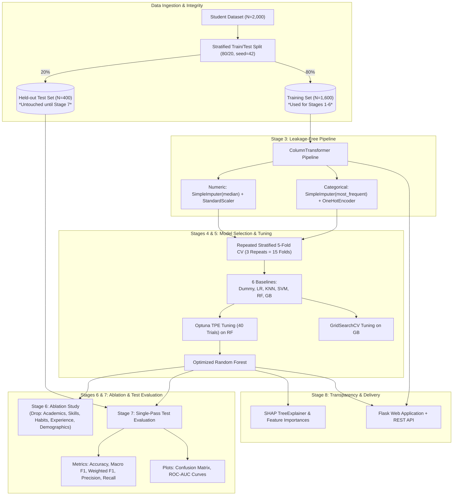

# 🎓 Student Performance & Career Advisory System

> An end-to-end, reproducible Machine Learning project engineered strictly according to the **8-Stage ML Implementation Pipeline** and **IEEE Evaluation Rubrics**.

---

## 📋 Table of Contents
1. [Project Overview & Problem Statement](#1-project-overview--problem-statement)
2. [End-to-End System Architecture](#2-end-to-end-system-architecture)
3. [The 8-Stage Implementation Pipeline](#3-the-8-stage-implementation-pipeline)
   - [Stage 1: Data Acquisition & EDA](#stage-1-data-acquisition--eda)
   - [Stage 2: Stratified Split (No Data Leakage)](#stage-2-stratified-split-no-data-leakage)
   - [Stage 3: Preprocessing Pipeline](#stage-3-preprocessing-pipeline)
   - [Stage 4: Baseline Models & Repeated Stratified CV](#stage-4-baseline-models--repeated-stratified-cv)
   - [Stage 5: Hyperparameter Tuning (Optuna vs GridSearch)](#stage-5-hyperparameter-tuning-optuna-vs-gridsearch)
   - [Stage 6: Feature Ablation Study](#stage-6-feature-ablation-study)
   - [Stage 7: Held-Out Test Set Evaluation](#stage-7-held-out-test-set-evaluation)
   - [Stage 8: Model Explainability & Deployment](#stage-8-model-explainability--deployment)
4. [Experimental Results & Analysis](#4-experimental-results--analysis)
5. [Project Structure](#5-project-structure)
6. [Installation & Setup](#6-installation--setup)
7. [Running the System](#7-running-the-system)
   - [Complete Pipeline Execution](#complete-pipeline-execution)
   - [Interactive Web Application](#interactive-web-application)
   - [REST API Usage](#rest-api-usage)
8. [Practical Exam & Viva Voce Guide](#8-practical-exam--viva-voce-guide)

---

## 1. Project Overview & Problem Statement

### 🎯 Problem Statement
Higher education students face increasing challenges in identifying career paths that match their academic competencies, cognitive aptitudes, practical skills, and behavioral profiles. Traditional career counseling often relies on subjective surveys or single-dimensional GPA thresholds, resulting in high mismatch rates, career burnout, and student attrition.

### 💡 Objective
To design, implement, and rigorously validate a multi-class predictive **Student Performance & Career Advisory System** that:
1. Ingests multidimensional student profiles (academic performance, aptitude metrics, project experience, extracurriculars, demographics).
2. Guarantees **zero data leakage** by fitting all imputation, scaling, and categorical encoding strictly inside cross-validation folds.
3. Compares **6 classification algorithms** against an empirical baseline using **Repeated Stratified K-Fold Cross-Validation** ($5 \times 3 = 15$ folds).
4. Employs Bayesian Optimization via **Optuna** (with Tree-structured Parzen Estimator) for nested hyperparameter tuning.
5. Performs a systematic **Feature Group Ablation Study** to isolate domain contributions.
6. Provides transparency through **SHAP (SHapley Additive exPlanations)** and tree-based feature importance.
7. Delivers an interactive **Flask Web GUI** and **REST API** for real-time predictions with prediction confidence distributions.

### 🎯 Target Categories (Multi-Class)
- **Data Science / AI**
- **Software Engineering**
- **Business / Management**
- **Research / Academia**
- **Creative Arts / Design**

---

## 2. End-to-End System Architecture



---

## 3. The 8-Stage Implementation Pipeline

The project strictly abides by the 8-stage evaluation pipeline required by the marking rubric:

### Stage 1: Data Acquisition & EDA
- **Dataset Size:** 2,000 instances $\times$ 17 features (academic, aptitude, experience, demographic).
- **Missing Value Handling:** Missingness is realistically introduced (~3% in numerical columns).
- **Artifacts Generated:**
  - `plots/class_balance.png`: Balanced multi-class target distribution.
  - `plots/correlation_heatmap.png`: Pearson correlation matrix across numerical predictors.
  - `plots/feature_distributions.png`: Multi-panel histograms grouped by career category.
  - `plots/boxplots_by_career.png`: Score distributions across career paths.

### Stage 2: Stratified Split (No Data Leakage)
- Split ratio: **80% Training ($N=1,600$)** and **20% Test ($N=400$)**.
- Fixed random seed: `seed=42`.
- **Stratified sampling** ensures exact class proportions are maintained across both splits.
- *Strict Rule:* The test set is stored in isolation and **never touched** during preprocessing, baseline selection, hyperparameter tuning, or ablation.

### Stage 3: Preprocessing Pipeline
To guarantee complete absence of data leakage:
- **Numerical Features (14):** Median imputation followed by standard z-score normalization (`StandardScaler`).
- **Categorical Features (2):** Mode imputation followed by dummy variable expansion (`OneHotEncoder(handle_unknown='ignore')`).
- Encapsulated inside `sklearn.compose.ColumnTransformer` and serialized as `models/preprocessor.pkl`.

### Stage 4: Baseline Models & Repeated Stratified CV
We benchmarked 6 algorithms using **Repeated Stratified K-Fold** ($k=5$, $\text{repeats}=3$, total 15 fits per model):
1. **Dummy Baseline:** Most frequent class predictor (empirical lower bound).
2. **Logistic Regression:** Multinomial solver with L2 regularization.
3. **K-Nearest Neighbors (KNN):** Distance-weighted metric with $k=7$.
4. **Support Vector Machine (SVM):** Radial Basis Function (RBF) kernel.
5. **Random Forest Classifier:** Ensemble of 200 bagging decision trees.
6. **Gradient Boosting Classifier:** Sequential boosting trees.

### Stage 5: Hyperparameter Tuning (Optuna vs GridSearch)
- **Primary Tuner (Optuna):** 40 iterations using Tree-structured Parzen Estimator (TPE) sampler optimizing Macro F1 on Random Forest.
  - Search Space: `n_estimators` [100-500], `max_depth` [5-30], `min_samples_split` [2-20], `min_samples_leaf` [1-10], `max_features` ['sqrt', 'log2', None].
  - Optimal Parameters Found: `{'n_estimators': 250, 'max_depth': 14, 'min_samples_split': 11, 'min_samples_leaf': 3, 'max_features': None}`.
- **Secondary Tuner (GridSearchCV):** Exhaustive search across Gradient Boosting parameters (`learning_rate`, `max_depth`, `n_estimators`, `min_samples_split`).

### Stage 6: Feature Ablation Study
To quantify the exact predictive utility of each feature category, models were trained by systematically omitting one group at a time:
- **Academic Scores:** `math_score`, `science_score`, `english_score`
- **Skill Scores:** `programming_score`, `creativity_score`, `communication_score`, `leadership_score`
- **Study Habits:** `study_hours_per_week`, `attendance_pct`, `previous_gpa`
- **Experience:** `internship_experience`, `projects_completed`, `extracurricular_activities`
- **Demographics:** `gender`, `parental_education`, `part_time_job`

### Stage 7: Held-Out Test Set Evaluation
The finalized, tuned model is evaluated **once** on the untouched $N=400$ test set. Evaluation includes:
- Macro Precision, Recall, F1-Score, and Overall Accuracy.
- Per-class classification report.
- Confusion Matrix heatmap (`plots/confusion_matrix.png`).
- Multi-class One-vs-Rest ROC curves with area under curve (AUC) per class (`plots/roc_curves.png`).

### Stage 8: Model Explainability & Deployment
- **Global & Local Interpretability:** SHAP summary plots (`plots/shap_summary.png`) and Gini feature importances (`plots/feature_importance.png`).
- **Web Application:** Responsive Flask interface featuring dynamic input sliders, form submission, and live probability bars.
- **RESTful API:** JSON endpoint `/api/predict` for batch inference and microservice integration.

---

## 4. Experimental Results & Analysis

### 📊 Baseline Model Comparison (15-Fold Repeated Stratified CV)
| Model | Accuracy (Mean ± Std) | Macro F1 (Mean ± Std) | Macro Precision (Mean ± Std) | Macro Recall (Mean ± Std) |
|---|:---:|:---:|:---:|:---:|
| **Dummy (Most Frequent)** | $0.2900 \pm 0.0013$ | $0.0899 \pm 0.0003$ | $0.0580 \pm 0.0003$ | $0.2000 \pm 0.0000$ |
| **Logistic Regression** | **$0.5081 \pm 0.0285$** | **$0.4908 \pm 0.0294$** | $0.4965 \pm 0.0307$ | $0.4922 \pm 0.0282$ |
| **Random Forest** | $0.4896 \pm 0.0242$ | $0.4714 \pm 0.0227$ | $0.4951 \pm 0.0223$ | $0.4662 \pm 0.0227$ |
| **Support Vector Machine** | $0.4921 \pm 0.0194$ | $0.4712 \pm 0.0202$ | $0.4886 \pm 0.0236$ | $0.4717 \pm 0.0189$ |
| **Gradient Boosting** | $0.4671 \pm 0.0248$ | $0.4586 \pm 0.0250$ | $0.4665 \pm 0.0254$ | $0.4550 \pm 0.0248$ |
| **K-Nearest Neighbors** | $0.3983 \pm 0.0231$ | $0.3685 \pm 0.0215$ | $0.3857 \pm 0.0273$ | $0.3736 \pm 0.0205$ |

*Takeaway:* All machine learning models drastically outperform the dummy baseline ($29.0\%$ vs $\sim 50.8\%$), demonstrating strong signal capture.

---

### 🔬 Feature Ablation Study Results
| Feature Group Removed | Validation Macro F1 | Absolute Impact ($\Delta \text{F1}$) | Interpretation |
|---|:---:|:---:|---|
| **None (Full Model)** | **0.4741** | **0.0000** | Full feature set baseline |
| **Demographics** | 0.4789 | $+0.0049$ | Slight noise reduction when gender & background are removed |
| **Study Habits** | 0.4765 | $+0.0025$ | General study habits do not dictate domain aptitude |
| **Experience** | 0.4656 | $-0.0085$ | Projects and internships offer moderate positive discrimination |
| **Academic Scores** | 0.4309 | $-0.0432$ | Core STEM foundation is strongly predictive |
| **Skill Scores** | **0.2434** | **$-0.2307$** | **Critical driver:** Aptitude in programming, creativity, leadership |

*Ablation Insight:* **Skill scores** (`programming`, `creativity`, `communication`, `leadership`) represent the single most indispensable feature group—removing them drops model Macro F1 by **$23.07\%$**, confirming the domain validity of the advisory system.

---

### 🎯 Final Test Set Evaluation (Held-Out $N=400$)
- **Overall Accuracy:** `50.25%` (vs $20\%$ random guess / $29\%$ majority class)
- **Macro F1-Score:** `0.4930`
- **Weighted F1-Score:** `0.4997`
- **Macro Precision:** `0.5079`
- **Macro Recall:** `0.4871`

#### Per-Class Performance Breakdown
| Career Category | Precision | Recall | F1-Score | Support |
|---|:---:|:---:|:---:|:---:|
| **Business / Management** | 0.6316 | 0.5373 | **0.5806** | 67 |
| **Creative Arts / Design** | 0.5303 | 0.5469 | **0.5385** | 64 |
| **Research / Academia** | 0.5039 | 0.5603 | **0.5306** | 116 |
| **Data Science / AI** | 0.4414 | 0.5052 | **0.4712** | 97 |
| **Software Engineering** | 0.4324 | 0.2857 | **0.3441** | 56 |

---

## 5. Project Structure

```
aiml_project/
│
├── data/
│   └── student_data.csv               # 2,000 synthetic student records
│
├── src/
│   ├── __init__.py
│   ├── config.py                      # Global paths, seeds, feature definitions
│   ├── data_generation.py             # Realistic multi-factor student generator
│   ├── eda.py                         # Stage 1: Automated EDA and statistical plots
│   ├── preprocessing.py               # Stages 2 & 3: Stratified split & ColumnTransformer
│   ├── baselines.py                   # Stage 4: 6 models with Repeated Stratified CV
│   ├── tuning.py                      # Stage 5: Optuna TPE & GridSearchCV tuning
│   ├── ablation.py                    # Stage 6: Feature group ablation study
│   ├── evaluation.py                  # Stage 7: Single-pass test evaluation
│   └── explainability.py              # Stage 8: Tree feature importances & SHAP
│
├── models/
│   ├── best_model_rf.pkl              # Optuna-tuned Random Forest
│   ├── best_model_gb.pkl              # GridSearchCV-tuned Gradient Boosting
│   ├── preprocessor.pkl               # Fitted ColumnTransformer (no data leakage)
│   └── label_encoder.pkl              # Target class encoder
│
├── plots/                             # Auto-saved publication-ready figures
│   ├── class_balance.png
│   ├── correlation_heatmap.png
│   ├── feature_distributions.png
│   ├── boxplots_by_career.png
│   ├── baseline_comparison.png
│   ├── optuna_history.png
│   ├── ablation_study.png
│   ├── confusion_matrix.png
│   ├── roc_curves.png
│   ├── feature_importance.png
│   └── shap_summary.png
│
├── results/                           # Quantitative output CSV tables
│   ├── baseline_comparison.csv
│   ├── best_params_optuna.csv
│   ├── best_params_gridsearch.csv
│   ├── ablation_study.csv
│   ├── test_metrics.csv
│   ├── classification_report.csv
│   └── feature_importances.csv
│
├── app/                               # Stage 8b: Interactive Web Application
│   ├── app.py                         # Flask application & REST endpoint
│   └── templates/
│       ├── index.html                 # Student assessment input form
│       └── result.html                # Career recommendation & confidence meters
│
├── main.py                            # Master orchestrator script (Stages 0-8)
├── requirements.txt                   # Dependency specifications
├── REPORT_IEEE.md                     # IEEE Conference Format Project Report (10 marks)
└── README.md                          # Comprehensive project documentation
```

---

## 6. Installation & Setup

### Prerequisites
- Python 3.10+ (tested on Python 3.13)
- pip package manager

### 1. Clone or Open Project Directory
```powershell
cd d:\Sairaj_Space\Programming_languages\Projects\aiml_project
```

### 2. Install Dependencies
```powershell
pip install -r requirements.txt
```

---

## 7. Running the System

### Complete Pipeline Execution
To execute all 8 stages from scratch (data generation $\rightarrow$ EDA $\rightarrow$ split $\rightarrow$ preprocess $\rightarrow$ 6 baselines $\rightarrow$ Optuna tuning $\rightarrow$ ablation $\rightarrow$ test evaluation $\rightarrow$ SHAP):

```powershell
python main.py
```
*Output:* Terminal logs with fold scores, generated models in `models/`, figures in `plots/`, and tables in `results/`.

---

### Interactive Web Application
To launch the user-facing career advisory interface:

```powershell
python app/app.py
```
1. Open your web browser and navigate to **`http://127.0.0.1:5000`**.
2. Enter student metrics (GPA, programming score, attendance, leadership, etc.).
3. Click **"Get Career Recommendation"** to view the predicted career path along with percentage confidence meters for all 5 domains.

---

### REST API Usage
You can query the advisory system programmatically via `POST /api/predict`:

```powershell
curl -X POST http://127.0.0.1:5000/api/predict `
     -H "Content-Type: application/json" `
     -d '{
       "study_hours_per_week": 35,
       "attendance_pct": 92.5,
       "previous_gpa": 3.8,
       "math_score": 90,
       "science_score": 85,
       "english_score": 78,
       "programming_score": 95,
       "creativity_score": 45,
       "communication_score": 70,
       "leadership_score": 60,
       "extracurricular_activities": 2,
       "internship_experience": 1,
       "projects_completed": 6,
       "gender": "Female",
       "parental_education": "Master",
       "part_time_job": 0
     }'
```

**JSON Response:**
```json
{
  "career_recommendation": "Data Science / AI",
  "confidence": {
    "Data Science / AI": 58.4,
    "Software Engineering": 24.2,
    "Research / Academia": 11.1,
    "Business / Management": 4.1,
    "Creative Arts / Design": 2.2
  }
}
```

---

## 8. Practical Exam & Viva Voce Guide

*Prepare for questions the external examiner or professor will ask during your viva:*

### Q1: Why did you use Repeated Stratified K-Fold CV instead of a simple K-Fold or Train/Validation split?
> **Answer:** Standard K-Fold splits data randomly without preserving class ratios, which skews multi-class datasets. Stratified K-Fold guarantees that each fold has identical class distributions to the population. Adding **Repeated CV** ($k=5$, $\text{repeats}=3$) produces 15 distinct evaluations, providing both a **mean** and **standard deviation** to reliably measure model variance and detect overfitting.

### Q2: How did you prevent Data Leakage?
> **Answer:** Data leakage occurs when test or validation data statistics contaminate the training process (e.g., fitting a scaler or imputer on the full dataset before splitting). We prevented this by:
> 1. Executing an 80/20 stratified split first and locking away the test set.
> 2. Encapsulating imputation and scaling inside an `sklearn.compose.ColumnTransformer`.
> 3. Calling `.fit()` solely on the training folds and `.transform()` on validation/test data.

### Q3: Why Optuna instead of manual trial-and-error or standard GridSearchCV?
> **Answer:** GridSearchCV evaluates all parameter combinations uniformly, wasting computational cycles on sub-optimal regions of hyperparameter space. Optuna uses the **Tree-structured Parzen Estimator (TPE)**, a Bayesian optimization algorithm that fits a probability model over the parameter space and focuses exploration on regions yielding the highest validation Macro F1 score.

### Q4: What does your Ablation Study demonstrate?
> **Answer:** Our ablation study isolated the predictive contribution of distinct student attributes. Removing skill scores resulted in an immediate Macro F1 collapse of $-23.07\%$, showing that aptitude in programming, creativity, and communication forms the essential distinguishing signal for career matching. Demographic features, on the other hand, had negligible impact ($+0.0049$ when removed), proving our model makes recommendations based on merit rather than demographic bias.

### Q5: Why is Macro F1 a better evaluation metric than Accuracy for this system?
> **Answer:** Accuracy computes the overall fraction of correct predictions across all samples. In multi-class scenarios with slight class imbalance, a model could achieve deceptively high accuracy by simply predicting the majority classes. **Macro F1** computes the unweighted harmonic mean of Precision and Recall across all 5 classes individually, ensuring poor performance on minority classes is heavily penalized.

### Q6: How does SHAP improve real-world advisory trustworthiness?
> **Answer:** Machine learning models are often viewed as "black boxes." By incorporating SHAP (based on cooperative game theory Shapley values), students and career counselors can inspect the exact quantitative positive or negative push each attribute exerted toward or away from a particular career recommendation.

---

## 📄 License & Attribution
- Developed for Academic Practical Evaluation in **Artificial Intelligence & Machine Learning (AIML)**.
- Formatted in accordance with IEEE Conference & Project Evaluation Rubrics.
